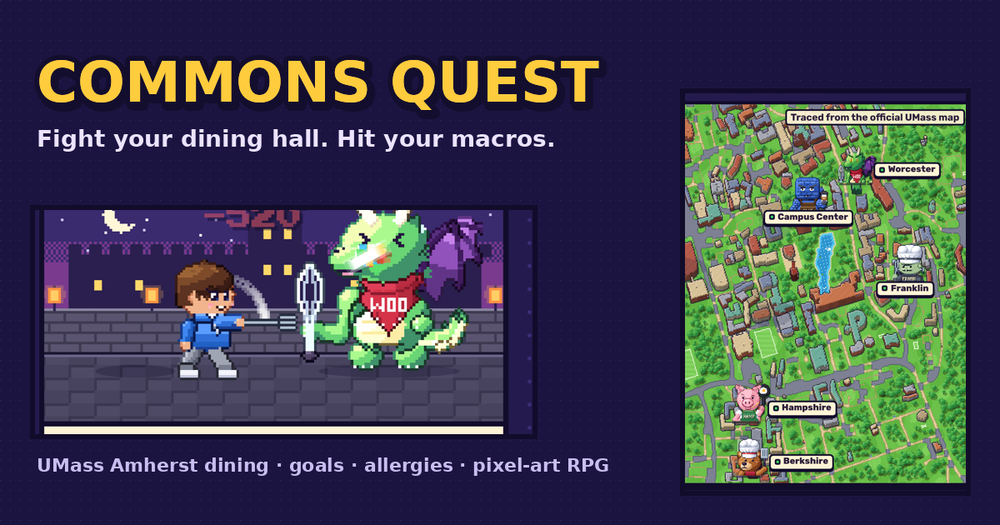
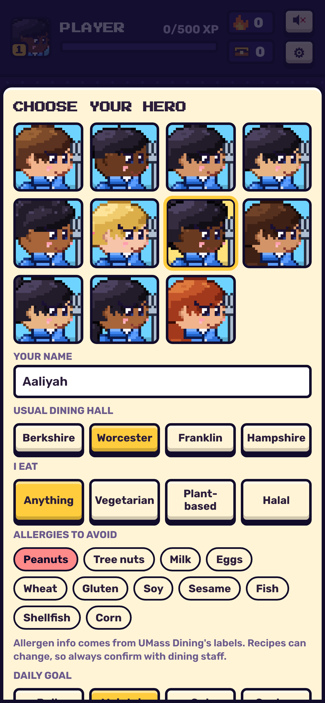
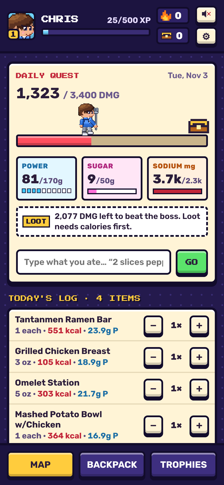
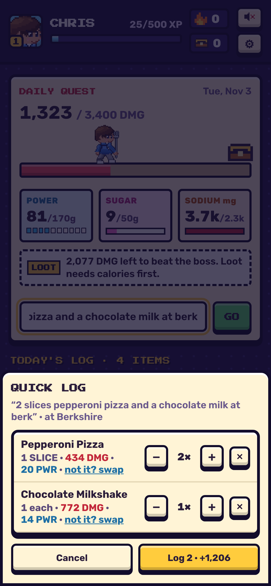
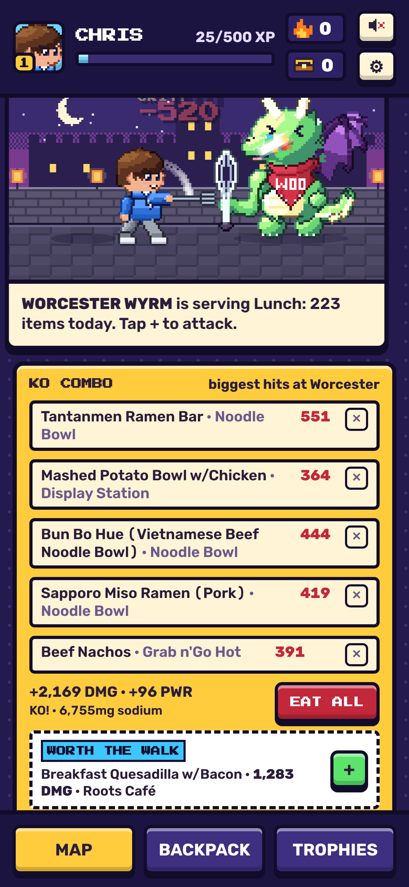
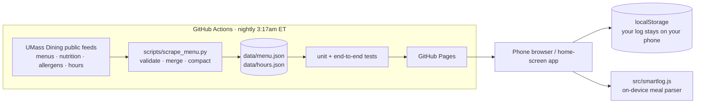

# Commons Quest



**A meal planner for UMass Amherst dining that knows your goals, your diet and your allergies, and turns eating well into a game.**

**▶ Live app:** https://chrisgarceau6-dev.github.io/commons-quest/ (best on a phone; tap **"try the demo"** to skip setup and look around with sample data)

UMass has a nationally ranked dining program, and it publishes nutrition and allergen data for every dish. But using that data is slow. You check four dining halls' menus one at a time, and nothing tells you *"what should I eat to hit 160 g of protein today, without nuts, at the hall I'm walking to?"* Generic trackers like MyFitnessPal don't know the dining hall menus, so students give up on logging.

Commons Quest answers that question in a few seconds, and gives you a reason to come back tomorrow.

| Set up in 20 seconds | Your day at a glance | Type what you ate | Every hall is a boss |
|---|---|---|---|
|  |  |  |  |

## What it does

- **Every menu on campus, refreshed nightly.** 14 days of menus for the four dining commons plus 25 cafés and retail spots, about 2,200 foods with full nutrition, allergens and diet flags. Today's hours show "open till 9pm" on the map.
- **Personal from the first minute.** Pick your character (11 options across genders and skin tones), your usual hall, your diet (vegetarian, plant-based, halal) and the allergens to avoid. Every suggestion respects all of it.
- **"Next move" suggestions.** A ready-made combo at your hall for the current meal that gets you to your calorie goal, plus one dish that's "worth the walk" to another hall.
- **It learns you.** Foods you keep logging rank higher, a **Your Usuals** list shows where your go-to dishes are served today, and a ✕ on any suggestion means it never comes back.
- **Type it, don't search it.** "2 slices pepperoni pizza and a chocolate milk at berk" becomes two logged items with quantities. This runs on the phone with no server and no API cost (see [`src/smartlog.js`](src/smartlog.js)).
- **A game that rewards consistency, not restriction.** Calories are the boss's HP, and up to three goals you pick (protein, carbs, fat, fiber, sugar, sodium, saturated fat or cholesterol, each as a target or a cap) decide your loot. Bulking? Beat the boss by reaching your calories. Cutting? Win by landing within 10% of them. Streaks and a trophy calendar track the month. Goals can't be set below a safe calorie floor.
- **A living campus map.** The real campus, traced from the official UMass map's vector data, redrawn as a 3/4-view pixel town. It has day, night and winter versions, a bus on Mass Ave and students walking the paths.
- **Works like an app.** Installs to the home screen, works offline with the last menus it saw, and backs up or restores your data from a file.

## How it's built



- **No backend, no accounts, $0 to run.** It's a static site on GitHub Pages. A nightly GitHub Action pulls UMass Dining's public feeds and commits fresh data. It only overwrites good data if the new pull passes sanity checks (no failed fetches, enough items), so a bad night can't blank the app.
- **Privacy by design.** Your food log never leaves your phone. There's no tracking code, no cookies and no account. See [PRIVACY.md](PRIVACY.md).
- **All art is code-generated.** The characters, bosses, backdrops and map come from Python scripts on a small pixel-art engine (volume shading, color ramps, selective outlines), not a sprite editor. See [`scripts/`](scripts/).
- **Tested on every push.** Unit tests cover the meal parser. An end-to-end test drives the real app in a headless phone browser: setup, allergen-safe suggestions, quick log, a boss fight, persistence across reloads, and no missing files or JS errors.

More detail: [docs/ARCHITECTURE.md](docs/ARCHITECTURE.md) · Product decisions: [docs/CASE_STUDY.md](docs/CASE_STUDY.md)

## Run it locally

```bash
npm start                 # serves the app at http://localhost:8000
npm run menus             # pull today's menus and hours from UMass Dining
npm install && npx playwright install chromium && npm test
```

## Status

Built in fall 2026 by [Chris Garceau](https://www.linkedin.com/in/chrisjgarceau) (UMass Amherst, Isenberg '29) as a product owner and designer working with an AI coding agent: I set the scope, design, privacy and launch decisions and ran the iteration loop, and the agent wrote most of the code. This is a student project. **It is not affiliated with or endorsed by UMass Amherst or UMass Dining.** Allergen information comes from UMass Dining's own labels; always confirm with dining staff.
