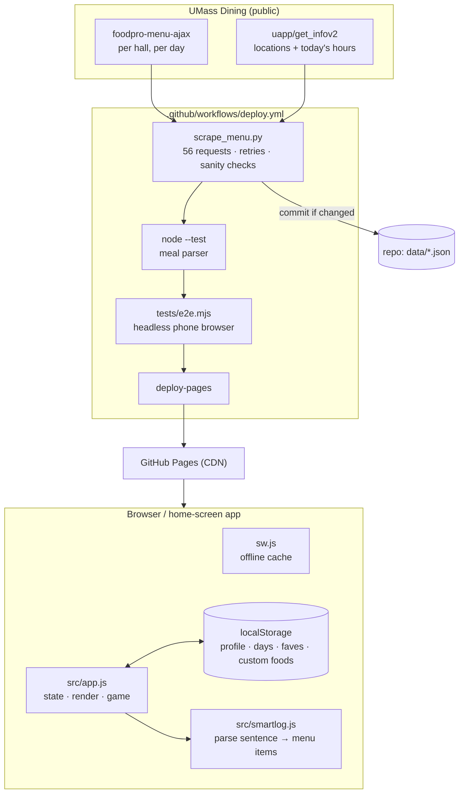

# Architecture

Commons Quest is a static web app. There's no server, database or account system. Everything that changes daily is a JSON file rebuilt by a scheduled GitHub Action.



## Data

`data/menu.json` stays small for phones (about 220 KB): each food is a compact array, not an object.

```
[name, serving, kcal, protein, carbs, fat, loc_indexes, meals, station, diet_flags, day_bitmask,
 fiber, sugar, sat_fat, trans_fat, cholesterol, sodium, allergen_codes]
```

- `day_bitmask`: bit *i* means "served on `dates[i]`". 14 days of menus share one row per dish instead of 14 copies.
- `meals`: `B L D N G` (breakfast, lunch, dinner, late night, grab'n go). `diet_flags`: `P` plant-based, `V` vegetarian, `H` halal.
- `allergen_codes`: `M E G W S C X F K P N` (milk, eggs, gluten, wheat, soy, corn, sesame, fish, shellfish, peanuts, tree nuts).

Retail and café items don't come from the daily feed. The scraper carries them forward, re-aiming their weekday pattern at the new 14-day window. When the same dish is on both a dining-hall menu and a café menu, it's merged into one entry.

**Failure policy:** if more than 8 of the 56 fetches fail, or fewer than 300 dining items come back, the scraper exits without writing. Yesterday's data stays live.

## App

`src/app.js` is plain JavaScript with no framework or build step. One state object drives a render function per tab, and DOM events are delegated through `data-act` attributes.

- **Recommendations** (`comboFor`, `worthWalk`, `usuals`). Candidates are today's items at the hall and meal, filtered by diet, avoided allergens, the user's ✕ list and a no-dessert rule. They're scored by calories toward the remaining goal, plus a boost for foods the user has logged before (capped, so suggestions don't collapse onto three dishes).
- **Quick log** (`src/smartlog.js`):
  - normalize → pull out a hall hint ("at berk") → split on commas and "plus"
  - split "and"/"with" only if both halves match better than the whole, so "mac and cheese" stays one dish and "burger and fries" becomes two
  - read the quantity ("2 slices", "half a", "x2")
  - score each menu item by word matching (exact, prefix, one-typo), weighting recall over precision so short typed phrases still find long dish names
  - return the best match plus up to 3 alternatives for a one-tap swap
- **Art.** Sprite sheets are CSS backgrounds animated with `steps()`. The map is a single image per time of day and season, with CSS-animated overlays: clouds, pond glints, a bus, walking students and pin glows. All motion respects `prefers-reduced-motion`.
- **Offline.** `sw.js` caches the app shell and art. Menus, hours and code are network-first, so updates land immediately but the app still opens in a dead-wifi dining hall.

## Art pipeline (`scripts/art`, `scripts/map`)

`pixart2.py` is a small pixel-art engine:
- primitives (ellipse, capsule, rect, polygon) write a material, a part ID and a surface normal per pixel
- rendering shades each pixel from one light source through a 5-step, hue-shifted color ramp
- it draws a selective outline (lighter on the lit side) and adds seams only where two parts of the same material overlap
- detail pixels (stitching, faces, letters) remember which part they were painted on and disappear if something is later drawn over that part, which prevents "detail bleeding through an arm" artifacts

The campus map is rebuilt from the official campus map PDF's vector paths:
- building footprints are extruded into walls with windows and a roof, sorted back to front
- roads are found by closing the gap between paired curb lines
- trees are placed by rejection sampling away from everything else
- night, winter and winter-night versions are palette transforms of the same render

## Tests

- `tests/smartlog.test.js`: quantities, multi-item sentences, "mac and cheese", slang, typos, hall hints, refusing to guess on nonsense.
- `tests/e2e.mjs` covers:
  - first-run setup saves hero, hall and allergies
  - combos never contain an avoided allergen
  - a typed sentence logs the right quantity
  - a fight logs food
  - settings has backup
  - data survives a reload
  - zero JavaScript errors and zero missing files
